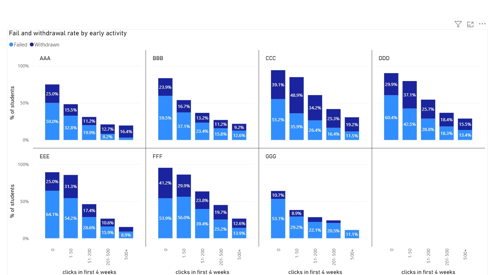

# Early Activity and Course Outcomes (OULAD)

Do students who are less active in the first four weeks of a course end up failing more often? This project explores that question with Python, SQL and Power BI.

## Dataset
The [Open University Learning Analytics Dataset (OULAD)](https://analyse.kmi.open.ac.uk/open_dataset) contains anonymised data on 32,593 course enrolments across 7 modules, including student demographics, assessments and more than 10 million clicks in the online learning platform. The data is not included in this repository because of its size.

## Question
Is the number of clicks in the first 28 days of a course related to the final result (Pass, Distinction, Fail, Withdrawn)?

## Approach
1. **Python (pandas):** explored the data, summed each student's clicks in days 0-27, and merged them with student information and registration dates.
2. **SQL (SQLite):** grouped students into activity groups (0, 1-50, 51-200, 201-500, 500+ clicks) and calculated fail and withdrawal rates for each group and module.
3. **Power BI:** built a dashboard comparing the rates across modules.

## Key findings
- Among students still enrolled after week 4, the fail rate falls from 57.1% for students with no clicks to 12.6% for students with 500+ clicks.
- The withdrawal rate falls more slowly (24.3% to 12.9%), so early activity says more about failing than about withdrawing later.
- The overall pattern is similar in all 7 modules (fail rates are highest for students with few clicks), although it is not perfectly smooth everywhere, and withdrawal rates differ a lot between modules.
- 5,040 students (15%) withdrew before day 28. I excluded them from the comparison, because they had no chance to be active.

## Dashboard

## Limitations
- This shows an association, not a cause: motivated students may both click more and study better.
- Some groups are very small (for example, only 18 students in module GGG with 500+ clicks), so their percentages are unstable.
- Activity is measured only by clicks, and the 28-day window is an arbitrary choice.
- No predictive model was built; this is a descriptive analysis.

## Project structure
- `scripts/` - numbered Python scripts in the order they were written
- `outputs/` - charts and summary tables
- `powerbi/` - Power BI dashboard file